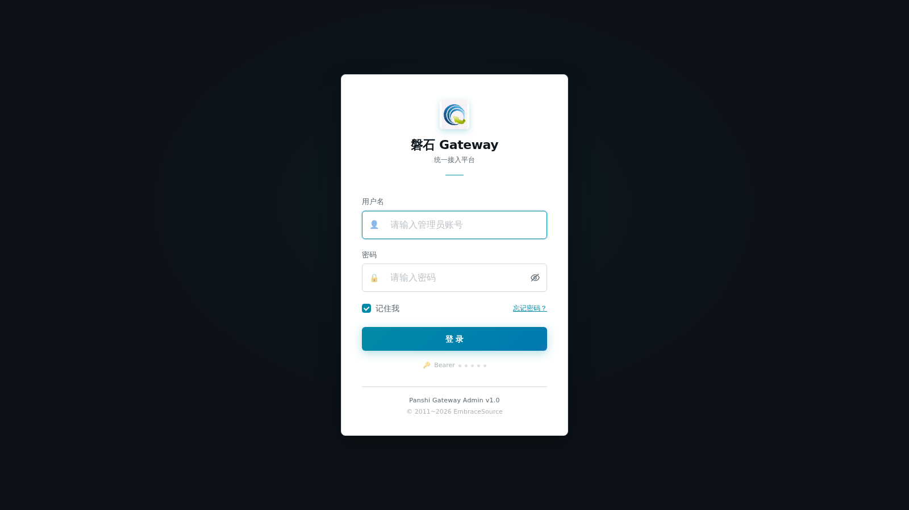
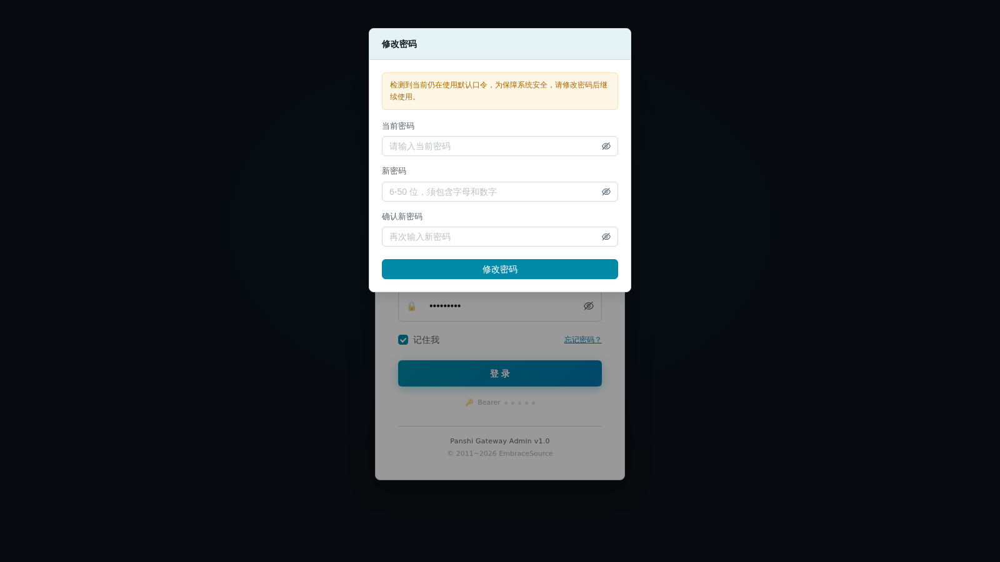
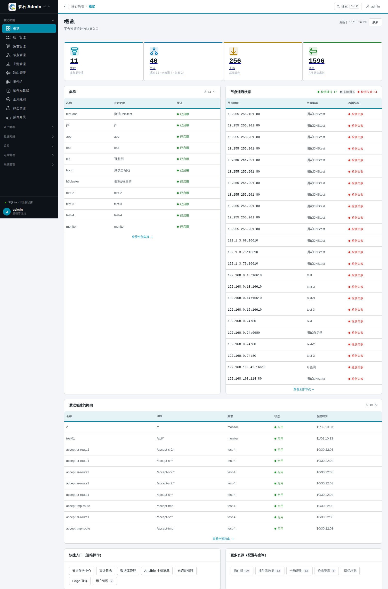
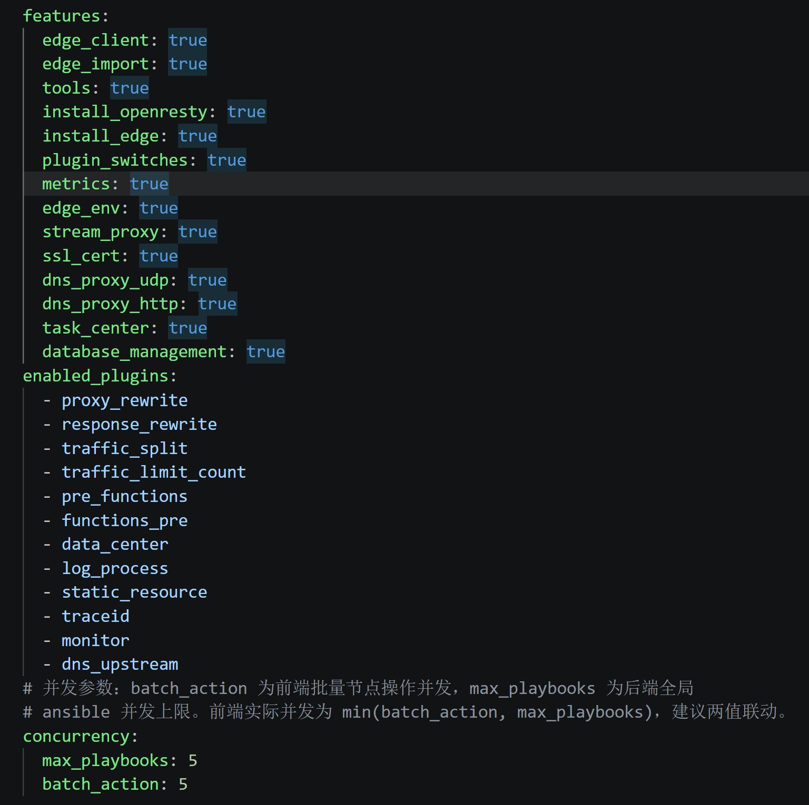
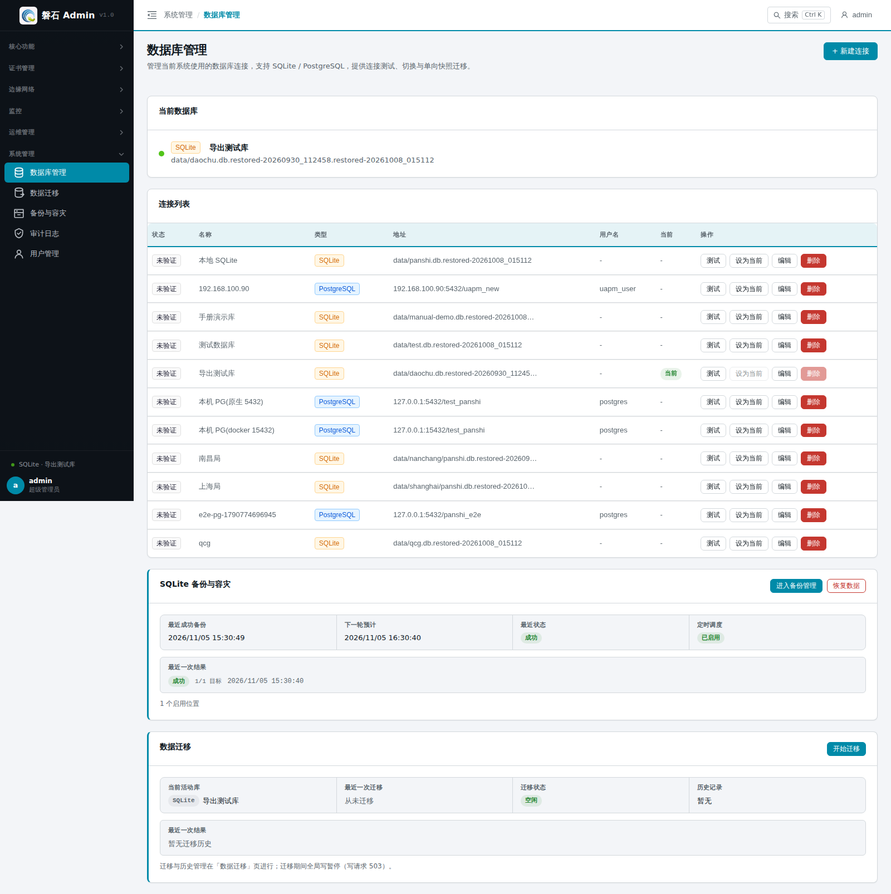
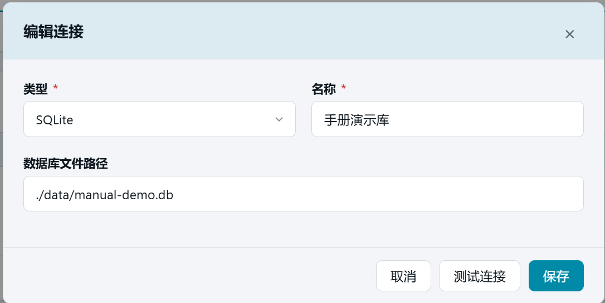
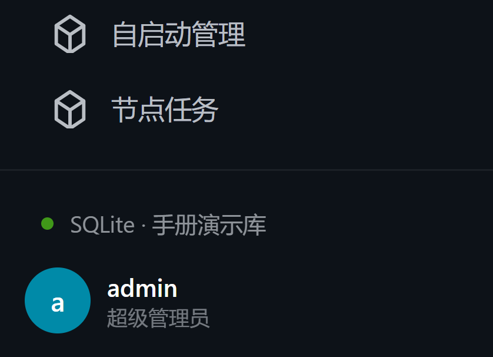

# 1. 登录与初始准备

> 本章目标：① 登录系统并认识界面；② 把系统切换到一个**干净的空数据库**上，保证后续章节从零开始。如果是在已有数据的生产环境学习，可跳过 1.4。

## 1.1 登录

> 默认账号：  
> 管理员：admin / panshi123

打开浏览器访问 <http://localhost:12345/> ，未登录时自动跳转到登录页，输入账号密码后点击【登 录】。

> ⚠️ **登录限流**：连续 5 次输入错误口令，该账号将锁定 10 分钟（提示剩余等待时间），期间正确口令也会被拒绝，请稍后再试。  
> 🔒 **首次登录强制改密**（可选开关）：启用 `force_default_password_change` 后，admin 仍持默认口令登录会被强制要求修改密码（弹窗不可关闭），改完才能进入系统；开关默认关闭。管理员也可随时经顶栏用户菜单 →【修改密码】主动改密——改密后所有已登录会话立即失效，需重新登录。

## 1.2 界面导览

登录后进入【概览】页面：

- **左侧侧边栏**：功能入口，按六个分组排列（分组顺序、组内顺序与下表一致）：
  - 【核心功能】：概览、统一管理、集群管理、节点管理、上游管理、路由管理、插件组、插件元数据、全局规则、静态资源、插件开关（第 2~12 章）
  - 【证书管理】：CA 根证书、服务器证书（第 13~14 章）
  - 【边缘网络】：edge.env 配置、四层代理、DNS代理[UDP]、DNS代理[HTTP]（第 15~18 章）
  - 【监控】：指标总览、指标查询、ClickHouse 配置（第 19~21 章）
  - 【运维管理】：Edge直连、数据导入、工具箱、自启动管理、Ansible 主机清单、节点任务、中继区域管理（第 22~28 章）
  - 【系统管理】：数据库管理、数据迁移、备份与容灾、审计日志、用户管理（第 29~33 章）
- **侧边栏底部**：当前数据库状态行（悬停显示库类型/地址/连接数；「切换待重启生效」时提示数据仍来自旧库，点击可进入数据库管理）+ 当前用户行（用户菜单：**修改密码** / 退出登录）。
- **顶部栏**：左侧面包屑显示当前页面位置，右侧为用户菜单。
- **内容区**：当前页面的操作主体。

> 💡 手册目录与侧边栏菜单一一对应：想找某个页面怎么用，直接按菜单分组查目录即可。

## 1.3 功能开关前置检查

> 部分菜单项受「功能开关」控制：开关关闭时，对应入口**不会出现在侧边栏**。  
> 如果后续章节要求你点击某个菜单却找不到，先回到本表核对开关是否开启。

| 菜单项 | 所属分组 | 开关名（features.yaml） |
| --- | --- | --- |
| 插件开关 | 核心功能 | `plugin_switches` |
| CA 根证书 / 服务器证书 | 证书管理 | `ssl_cert` |
| edge.env 配置 | 边缘网络 | `edge_env` |
| 四层代理 | 边缘网络 | `stream_proxy` |
| DNS代理[UDP] | 边缘网络 | `dns_proxy_udp` |
| DNS代理[HTTP] | 边缘网络 | `dns_proxy_http` |
| 指标总览 / 指标查询 | 监控 | `metrics` |
| ClickHouse 配置 | 监控 | `clickhouse_config` |
| Edge直连 | 运维管理 | `edge_client` |
| 数据导入 | 运维管理 | `edge_import` |
| 工具箱 | 运维管理 | `tools` |
| 自启动管理 | 运维管理 | `edge_autostart` |
| Ansible 主机清单 | 运维管理 | `ansible_inventory` |
| 节点任务 | 运维管理 | `task_center` |
| 中继区域管理 | 运维管理 | `relay_gateway` |
| 数据库管理 | 系统管理 | `database_management` |
| 数据迁移 | 系统管理 | `db_migration` |
| 备份与容灾 | 系统管理 | `db_backup` |
| 审计日志 | 系统管理 | `audit_log` |

开启方法：编辑后端配置文件 `backend/features.yaml`，把对应开关改为 `true` 并保存。

> 开发环境下保存后服务会自动重载（热生效）；生产环境需重启服务后刷新页面。

## 1.4 准备干净的演示数据库

> 系统使用哪个数据库由连接配置决定，切换数据库 = 修改配置 + 重启后端服务。  
> ⚠️ 生产环境请勿随意切换数据库，本章操作仅用于搭建演示环境。

### 1.4.1 新增 SQLite 连接

点击左侧侧边栏：【系统管理】-> 【数据库管理】，在右侧内容区的【连接列表】中，点击【+ 添加连接】：

填写连接数据：

| 字段 | 填写值 | 说明 |
| --- | --- | --- |
| 类型 | SQLite | 使用本地文件库 |
| 名称 | 手册演示库 | 连接的显示名称 |
| 数据库文件路径 | ./data/manual-demo.db | 文件不存在没关系，重启后自动创建 |

添加连接弹窗，SQLite 类型，路径填 ./data/manual-demo.db）

填写完成后可先点【测试连接】，再点【保存】。

### 1.4.2 设为当前并重启

在【连接列表】中找到「手册演示库」一行，点击【设为当前】，弹窗中点击【确认切换】。

> ⚠️ 切换只修改配置文件，必须手动重启后端服务才生效：  
> - 生产环境：`cd <项目目录>` 后执行 `develop/linux/stop.sh`、`develop/linux/start.sh`

### 1.4.3 验证

重启完成后刷新页面：

- 「当前数据库」卡片显示：SQLite · ./data/manual-demo.db
- 回到【概览】页，所有资源计数为 0（用户除外）

当前数据库卡片显示手册演示库

## 1.5 快速上手路线图（学习主线）

> 本手册目录顺序 = 侧边栏菜单顺序，便于按页面查找；但**第一次从零搭建**请按下表主线顺序操作（数据前后衔接）：

| 步骤 | 章节 | 做什么 |
| --- | --- | --- |
| 1 | 第 1 章 | 登录 + 准备演示库（本章） |
| 2 | 第 4 章 | 建集群 |
| 3 | 第 5 章 | 录入节点 |
| 4 | 第 15 章 | 修改 edge.env（监听端口与插件开关） |
| 5 | 第 10 章 | 建全局规则 |
| 6 | 第 9 章 | 配置插件元数据 |
| 7 | 第 8 章 | 创建插件组 |
| 8 | 第 6 章 | 添加上游 |
| 9 | 第 7 章 | 添加路由 |
| 10 | 第 13~14 章 | 生成 CA 根证书与服务器证书并发布 |
| 11 | 第 16 章 | 建四层代理 |
| 12 | 第 17 章 | 建 DNS 代理（UDP） |
| 13 | 附录 B | 绑定域名，全链路验证 |
| 14 | 第 2 章 | 回概览巡检健康与流量 |

## 1.6 本章小结

- 登录地址与默认账号：<http://localhost:12345/> ，admin / panshi123
- 界面 = 左侧导航（六分组）+ 顶部栏 + 内容区；手册目录与菜单一一对应
- 登录限流 5 次/10 分钟；顶栏菜单可改密；强制改密为可选开关
- 切换数据库的固定流程：添加连接 → 测试 → 设为当前 → 重启后端 → 验证

下一步：按[1.5 路线图](#15-快速上手路线图学习主线)第 2 步，前往[第 4 章 集群管理](04-cluster.md)
