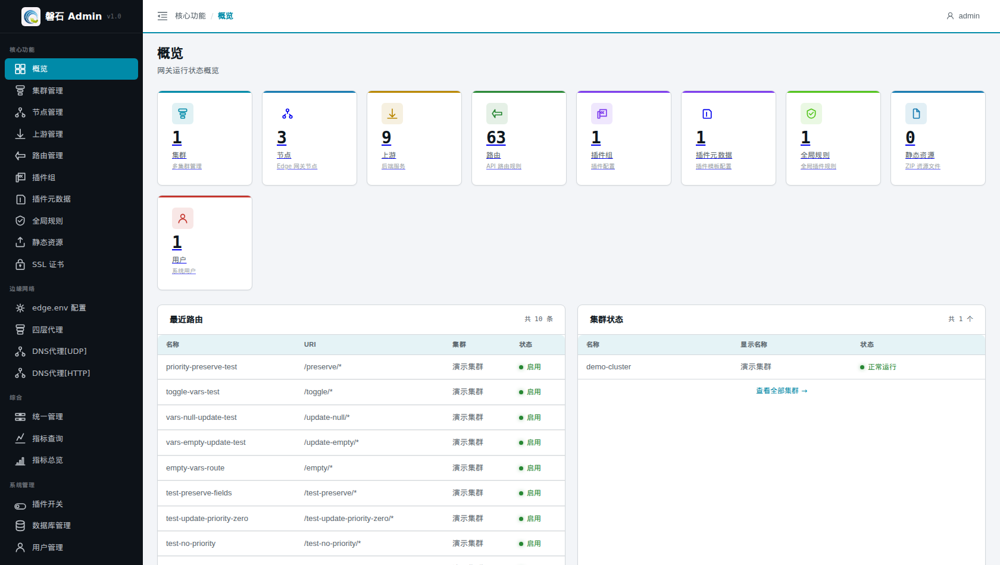

# 2. 概览（健康速览）

> 本章场景：日常巡检的第一站。概览页回答一个问题——**系统现在缺什么、坏了吗**。它与第 19~20 章的「指标总览 / 指标查询」分工不同：本页看**资源与健康状态**（运维视角），指标页看**流量与性能**（性能视角），配合使用。

## 2.1 页面入口

登录后默认进入，或点击左侧侧边栏：【核心功能】→【概览】。

## 2.2 统计卡片

页面排列 **4 张**统计卡片，每张显示当前数量，**点击可直接跳转**到对应管理页：

| 卡片 | 含义 | 跳转 |
| --- | --- | --- |
| 集群 | 多集群管理的集群总数 | 集群管理 |
| 节点 | Edge 网关节点数（含健康子说明） | 节点管理 |
| 上游 | 后端服务数 | 上游管理 |
| 路由 | API 路由规则数 | 路由管理 |

> 💡 卡片按账号权限过滤：无某模块权限时不显示对应卡片。

各资源的完整数量可在对应管理页查看；集群维度 per-资源统计（含插件组/全局规则/插件元数据/静态资源）见集群卡片 7 格统计（[第 4 章 4.3](04-cluster.md)）。

## 2.3 巡检方法

1. **对照预期数量**：按主线搭建完成后，集群=1、节点=3、上游≥1、路由≥1；某项为 0 说明对应章节漏做或资源被删。
2. **顺链路点检**：从「集群」开始逐卡跳转，重点确认节点列表中三台机器均为在线/启用状态——节点掉线时后续所有发布都会失败（排查见[15.3.4 发布失败排查](15-edge-env.md)）。
3. **健康之后看流量**：需要分析 QPS、连接数、延迟等运行指标时，前往[第 19 章 指标总览](19-metrics-dashboard.md)。

## 2.4 本章小结

- 概览 = 4 张资源数量卡（集群/节点/上游/路由）+ 快捷跳转入口，不提供编辑操作
- 数字为 0 或与预期不符 → 回到对应章节补建
- 流量性能问题请使用指标总览/查询（第 19~20 章）

下一步：[第 3 章 统一管理](03-central-management.md)
