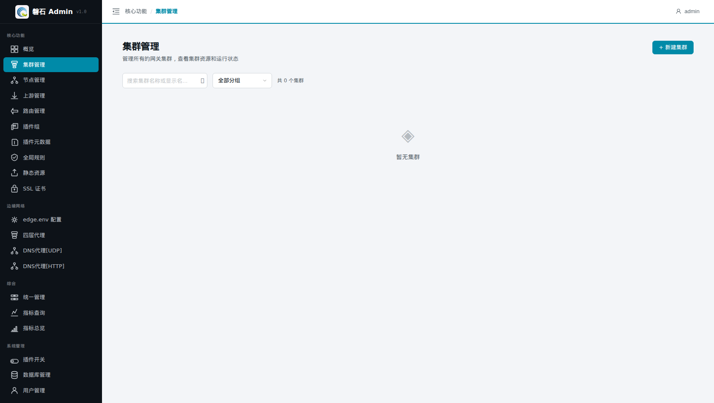
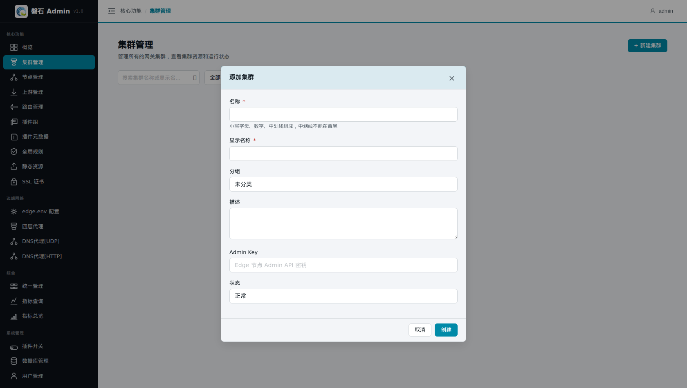
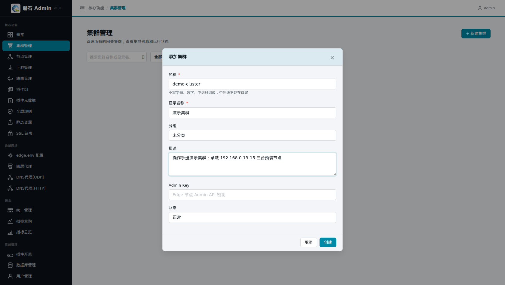
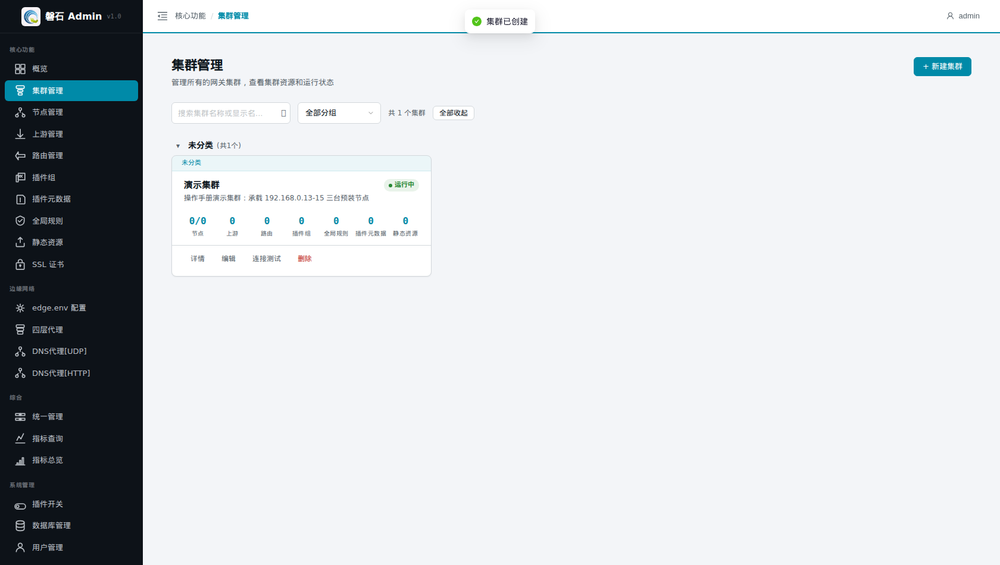
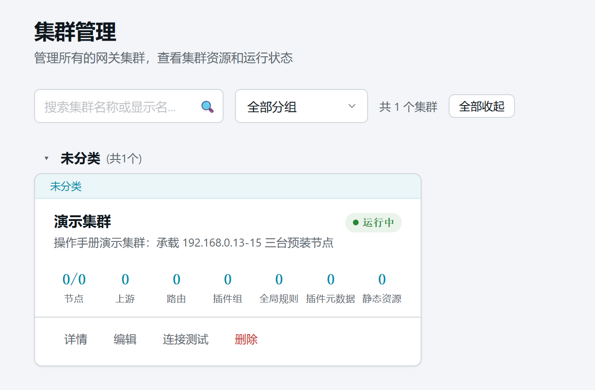

# 4. 集群管理

> 本章场景：我们有 3 台已经装好网关（OpenResty + Edge）的机器，需要交给磐石 Admin 统一管理。第一步是建立一个"集群"，作为这批机器和它们全部配置的容器。

## 4.1 集群是什么

**集群是服务器节点的集合，也是一套网关配置的边界。**

- 后续的节点、路由、上游、插件、证书等所有资源，都必须挂在某个集群下；
- "发布"动作以集群为单位：把配置推送到该集群内的节点上；
- 多套业务环境可以建多个集群，互不影响。

## 4.2 添加集群

点击左侧侧边栏：【核心功能】-> 【集群管理】，在右侧内容区内，点击【+ 新建集群】，进入【添加集群】页面：

填写集群数据：

| 字段 | 本例填写 | 说明 |
| --- | --- | --- |
| 名称 | demo-cluster | 集群的内部标识，只能用**小写字母、数字、中划线**，中划线不能在首尾；创建后不可修改 |
| 显示名称 | 演示集群 | 界面上展示的中文名，列表和下拉框显示的是它 |
| 分组 | （留空） | 给多个集群归类便于筛选，可现场新建分组；不填归入「未分组」（列表中未分组组头固定在第一行） |
| 描述 | 操作手册演示集群：承载 192.168.0.13-15 三台已装好网关软件的节点 | 备注信息 |
| Admin Key | （留空） | 与 Edge 节点通信验证的密钥，**必须与节点安装时设置的一致**；一般不用设置，不填系统会使用默认值 |
| 所属区域 | （留空） | 跨中心中继场景：挂接区域后该集群节点经对应路局网关执行（详见[第 28 章 中继区域管理](28-relay-gateways.md)）；留空 = 直连。区域变更保存后系统会提示「需下发网关配置」 |
| 状态 | 正常 | 禁用后该集群不可发布 |

> ⚠️ 常见错误：名称填了中文或大写会提示格式错误。中文请填到「显示名称」。

点击【创建】后，列表中出现新集群：

## 4.3 验证与卡片操作区

在【集群管理】列表中可以看到 `demo-cluster / 演示集群` 卡片，状态为正常。

集群卡片自上而下：

- **标题条**：技术身份（标识名 + 区域徽章，区域非空时显示）与右上角【最大化】入口；
- **统计格（7 格）**：节点（健康数/总数）、上游、路由、插件组、全局规则、插件元数据、静态资源——点击直接跳到对应管理页；
- **操作区**：【详情】/【连接测试】/【**漂移检测**】/【编辑】/【更多 ▾】（备份下载、导出 Excel）/【删除】。

漂移检测用于发现「Edge 运行态被绕过平台修改」的情况，详见[附录 E](E-drift-detection.md)。

## 4.4 本章小结

- 先有集群，才能挂节点和配置
- 名称 = 英文标识不可改；显示名称 = 中文展示名；分组留空归入「未分组」（置顶显示）
- Admin Key 必须与 Edge 节点实际密钥一致
- 卡片 7 格统计可直接跳页；漂移检测入口在卡片操作区

下一步：按主线前往[第 5 章 节点管理](05-nodes.md)
