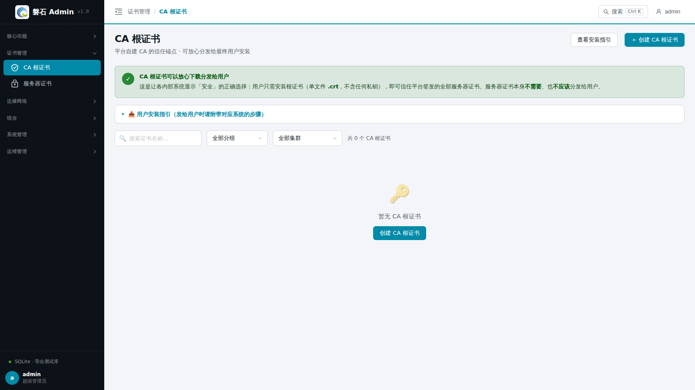
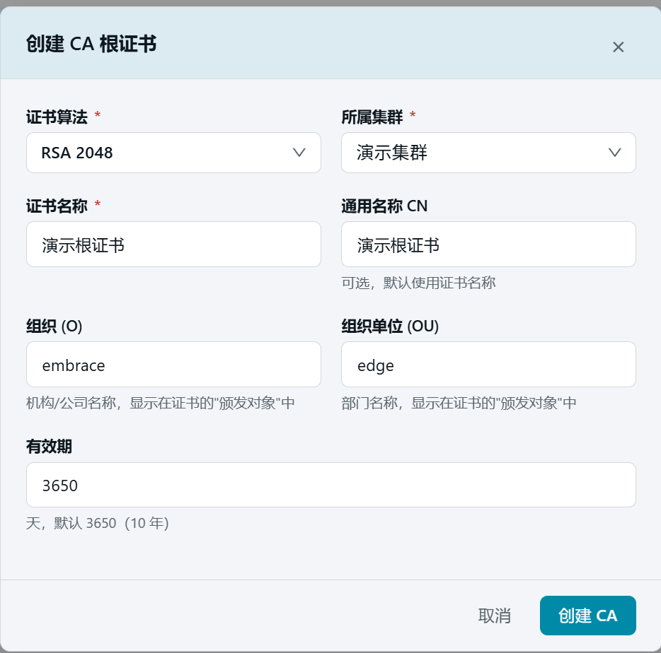
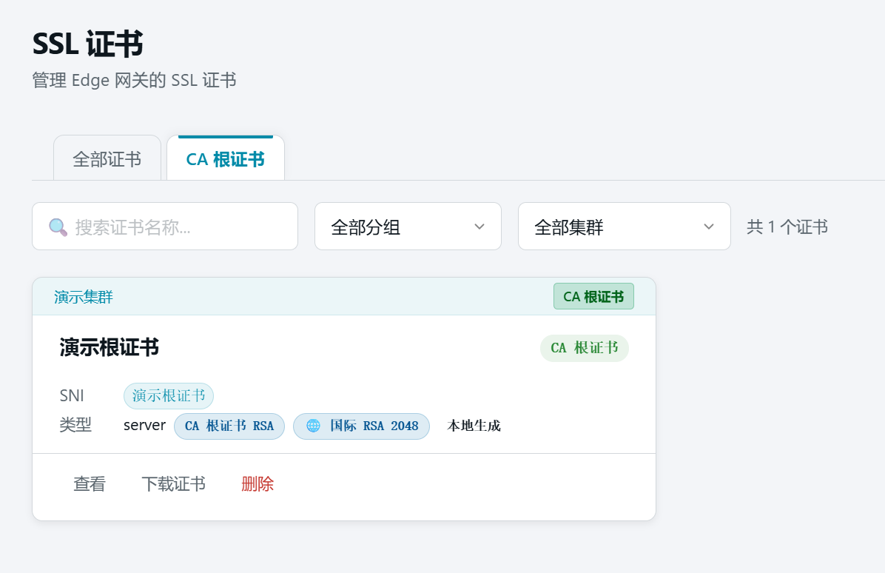
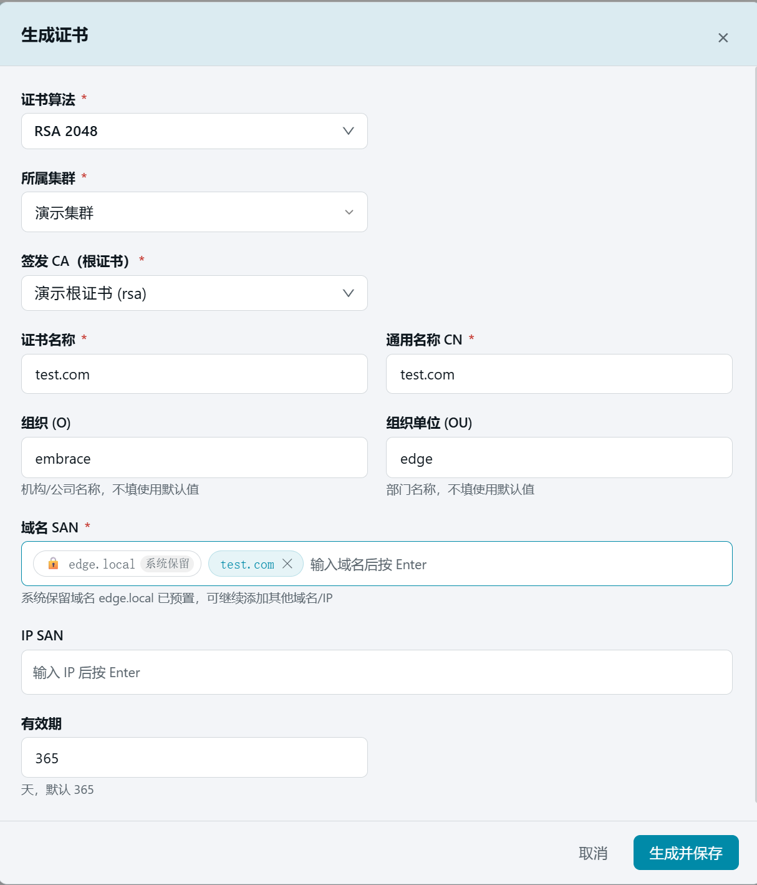
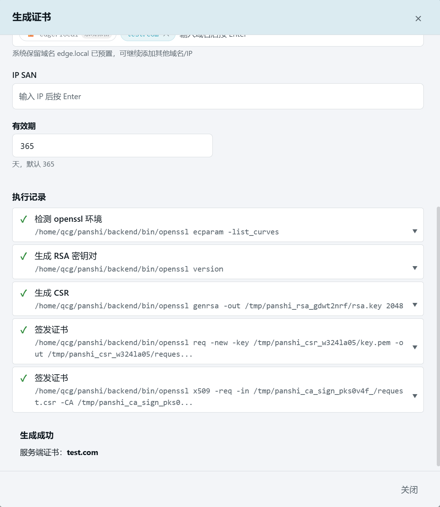
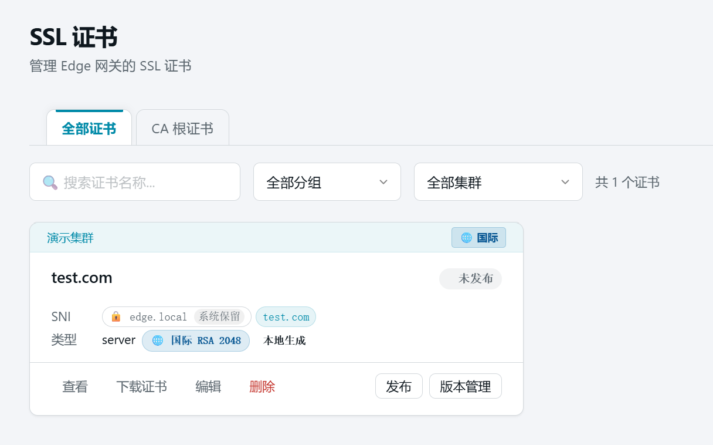
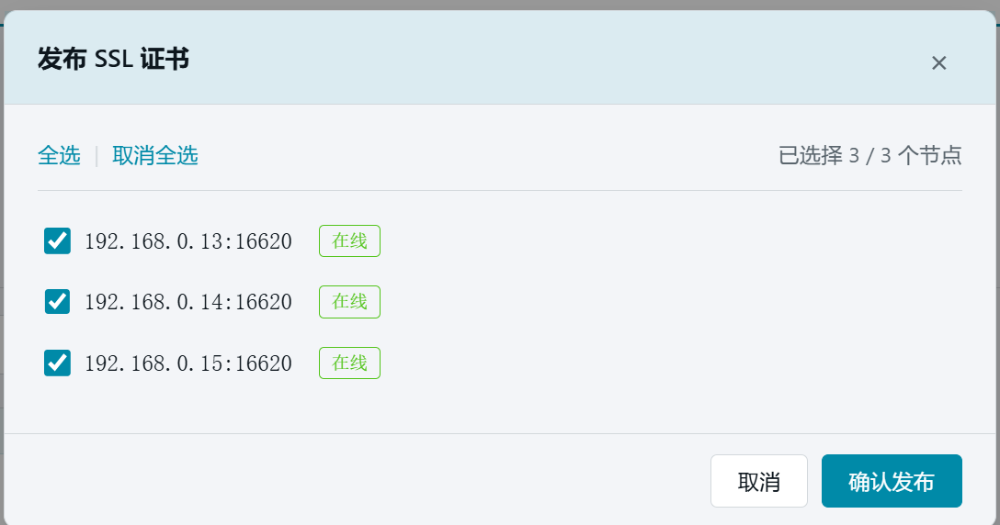
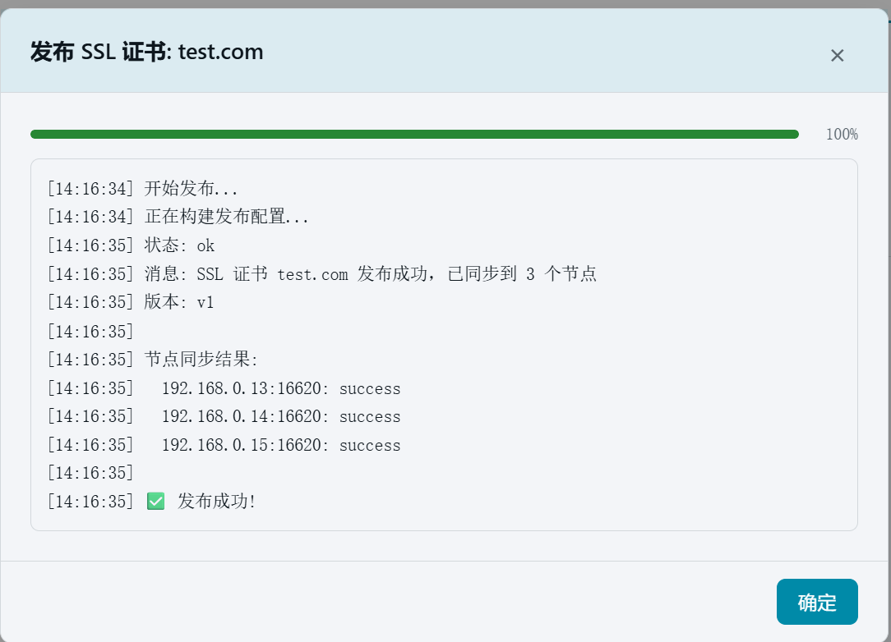

# 10. 证书管理

> 本章场景：为 HTTPS 接入做准备。先生成一张 RSA 算法的 CA 根证书（相当于自建的小型证书颁发机构），再用它签发一张 `test.com` 的服务器证书并发布到节点。根证书只用于签发，不需要发布。

## 10.1 证书是什么

磐石Admin 中的 SSL 证书分两类：

- **CA 根证书**：签发其他证书的"根"，保存在管理端即可，**无需发布到节点**。
- **服务器证书**：由根证书签发、绑定域名（如 `test.com`）的实际 HTTPS 证书，必须发布到节点才能被网关使用。

算法支持三种：RSA（国际通用）、ECC（更短更快）、SM2（国密）。本章全程使用 RSA。

## 10.2 第一步：生成根证书

1. 点击左侧侧边栏：【证书管理】→【CA 根证书】，进入 CA 根证书页面。
2. 首次进入时列表为空，显示"暂无 CA 根证书"与创建引导。页面顶部常驻绿色横幅：**CA 根证书可以放心下载分发给用户**（单文件 `.crt`、不含任何私钥），需要时可展开【用户安装指引】查看 Windows / macOS / Chrome / Linux 四段安装步骤。

   

3. 点击【+ 创建 CA 根证书】按钮，弹出创建对话框：

   | 字段 | 本例填写 | 说明 |
   | --- | --- | --- |
   | 证书算法 | 【RSA 2048】 | 根证书与由它签发的证书算法需一致 |
   | 所属集群 | 【演示集群】 | 根证书归属的集群 |
   | 证书名称 | `演示根证书` | 唯一标识 |
   | 通用名称 CN | 可留空 | 不填默认取证书名称 |
   | 组织 (O) / 组织单位 (OU) | 可留空 | 默认 EMBRACE / EDGE |
   | 有效期 | 默认 | 根证书建议设置较长有效期 |

   

4. 点击【创建 CA】。完成后列表出现"演示根证书"卡片，带【CA 根证书 RSA】徽章。

   

   > ⚠️ 注意：CA 根证书卡片上没有【发布】按钮——这是正常的。根证书只在签发证书时使用，不需要下发到节点。

## 10.3 第二步：生成服务器证书

1. 点击左侧侧边栏：【证书管理】→【服务器证书】（页面顶部警示横幅：服务器证书请勿分发给终端用户，用户系统应安装 CA 根证书），点击右上角【生成证书】按钮。

   
2. 按下表填写：

   | 字段 | 本例填写 | 说明 |
   | --- | --- | --- |
   | 证书算法 | 【RSA 2048】 | 与根证书一致 |
   | 所属集群 | 【演示集群】 | 选择后才会加载该集群的根证书 |
   | 签发 CA（根证书） | 【演示根证书 (rsa)】 | 由第一步生成的根证书签发 |
   | 证书名称 | `test.com` | 唯一标识 |
   | 通用名称 CN | `test.com` | 证书主体域名 |
   | 组织 (O) / 组织单位 (OU) | 可留空 | 默认 EMBRACE / EDGE |
   | 域名 SAN | 输入 `test.com` 后按 Enter | 系统保留域名 `edge.local` 已预置 |
   | IP SAN | 可留空 | 如需按 IP 访问可添加 |
   | 有效期 | 默认 365 天 | |

   

   

3. 点击【生成并保存】。系统在本地完成密钥生成与签发，对话框底部显示执行记录。

   

4. 点击【关闭】。列表出现"test.com"证书卡片，状态为"未发布"。

   

   > 💡 生成的证书支持【下载证书】导出 `.crt` 文件（不含私钥）。注意：**终端用户系统应安装的是 CA 根证书，而非服务器证书**；证书更新后已下载副本即失效，需重新下载。客户端证书（mTLS 用）请在对应证书的「查看」抽屉中下载完整安装包。

## 10.4 第三步：发布证书

服务器证书必须发布到节点才能生效：

1. 在"test.com"证书卡片上点击【发布】。
2. 在弹出的节点选择窗口中点击【全选】选中全部 3 个节点。

   

3. 点击【确认发布】，等待发布结果。

   

   > ⚠️ 如果出现「部分成功」，说明某台节点管理端口可能不通，需要修复该节点后重新发布。其余节点不受影响。

## 10.5 验证

1. 发布完成后，"test.com"卡片显示【已发布】徽章和版本号（v1）。

## 10.6 本章小结

- CA 根证书 = 签发工具，不发布；服务器证书 = 实际 HTTPS 证书，必须发布。
- **发给用户的永远是 CA 根证书**（在 CA 根证书页面单文件直下 `.crt`，不含私钥）；服务器证书只部署在网关，请勿分发给终端用户。
- 本例生成了 RSA 根证书"演示根证书"，并由它签发了 `test.com` 服务器证书（SAN 含 test.com，有效期 365 天）。
- 证书发布成功后即可在第 13 章的域名绑定中使用。

下一步：[10. 四层代理（TCP/UDP 端口转发）](11-stream-proxy.md)
