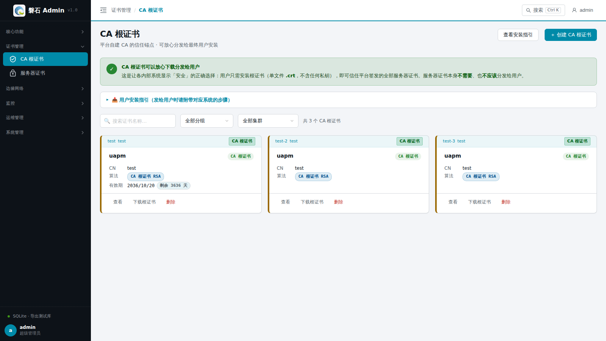
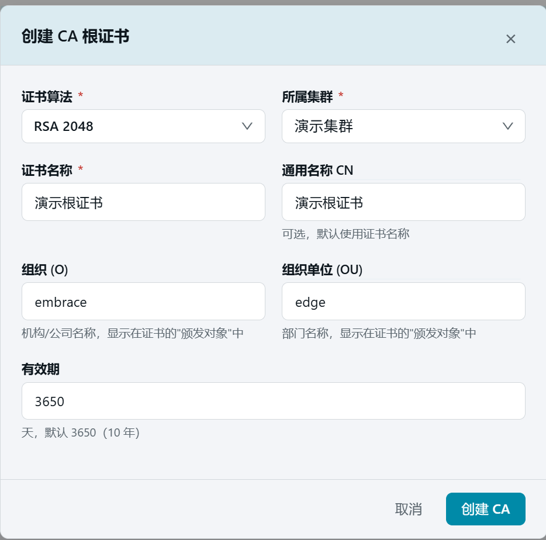
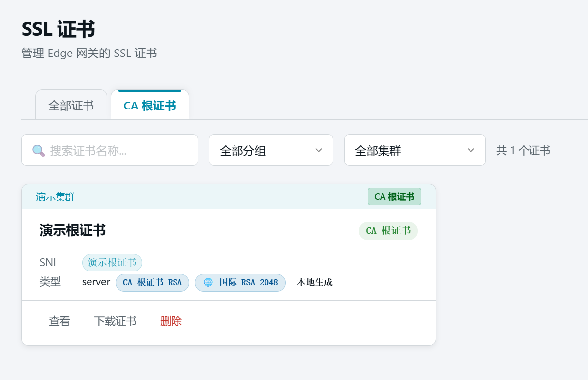

# 13. CA 根证书

> 本章场景：为 HTTPS 接入做准备。先生成一张 RSA 算法的 CA 根证书——相当于自建一个小型证书颁发机构，后续所有服务器证书（第 14 章）都由它签发。根证书只用于签发，**不需要发布到节点**。

## 13.1 证书是什么

磐石Admin 中的 SSL 证书分两类：

- **CA 根证书**：签发其他证书的"根"，保存在管理端即可，**无需发布到节点**（本章）。
- **服务器证书**：由根证书签发、绑定域名（如 `test.com`）的实际 HTTPS 证书，必须发布到节点才能被网关使用（第 14 章）。

算法支持三种：RSA（国际通用）、ECC（更短更快）、SM2（国密）。本章全程使用 RSA。

## 13.2 生成 CA 根证书

1. 点击左侧侧边栏：【证书管理】→【CA 根证书】，进入 CA 根证书页面。
2. 首次进入时列表为空，显示"暂无 CA 根证书"与创建引导。页面顶部常驻绿色横幅：**CA 根证书可以放心下载分发给用户**（单文件 `.crt`、不含任何私钥），需要时可展开【用户安装指引】查看 Windows / macOS / Chrome / Linux 四段安装步骤。

   

3. 点击【+ 创建 CA 根证书】按钮，弹出创建对话框：

   | 字段 | 本例填写 | 说明 |
   | --- | --- | --- |
   | 证书算法 | 【RSA 2048】 | 根证书与由它签发的证书算法需一致 |
   | 所属集群 | 【演示集群】 | 根证书归属的集群 |
   | 证书名称 | `演示根证书` | 唯一标识 |
   | 通用名称 CN | 可留空 | 不填默认取证书名称 |
   | 组织 (O) / 组织单位 (OU) | 可留空 | 默认 EMBRACE / EDGE |
   | 有效期 | 默认 | 根证书建议设置较长有效期 |

   

4. 点击【创建 CA】。完成后列表出现"演示根证书"卡片，带【CA 根证书 RSA】徽章。

   

   > ⚠️ 注意：CA 根证书卡片上没有【发布】按钮——这是正常的。根证书只在签发证书时使用，不需要下发到节点。

## 13.3 验证

- CA 根证书列表出现"演示根证书"卡片，带【CA 根证书 RSA】徽章；
- 卡片支持【下载证书】导出单文件 `.crt`（不含私钥），可直接分发给终端用户安装（浏览器安装步骤见附录 C）。

## 13.4 本章小结

- CA 根证书 = 签发工具，**不发布**；服务器证书 = 实际 HTTPS 证书，必须发布（第 14 章）。
- **发给用户的永远是 CA 根证书**（本页单文件直下 `.crt`，不含私钥）。
- 本例生成了 RSA 根证书"演示根证书"，下一章用它签发 `test.com` 服务器证书。

下一步：[14. 服务器证书与发布](14-ssl-server.md)
