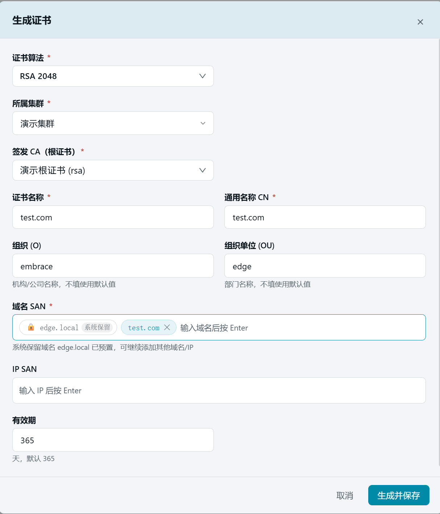
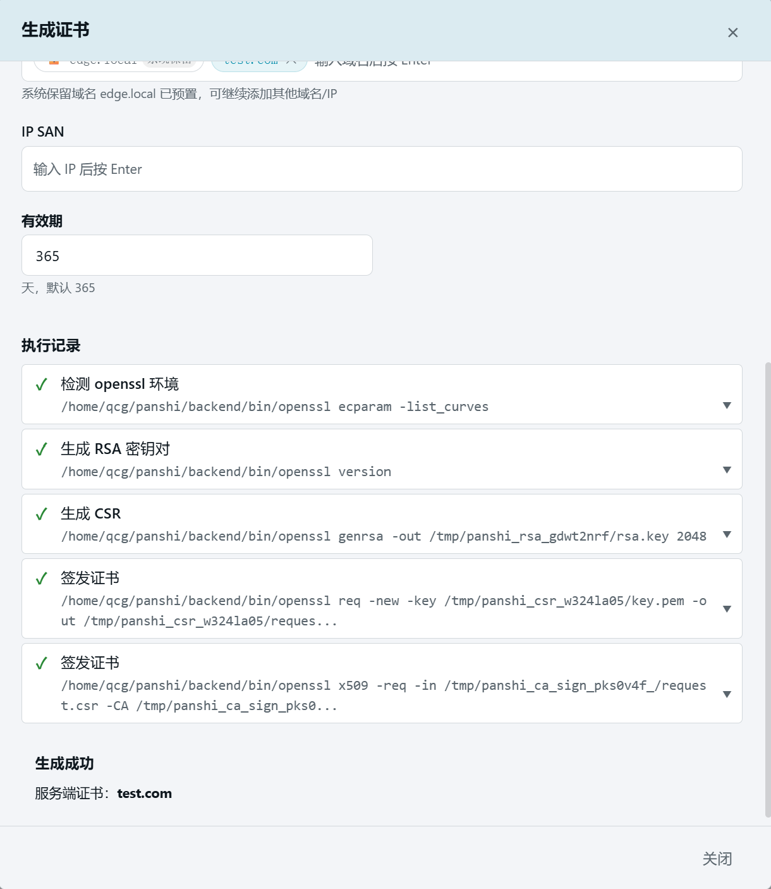
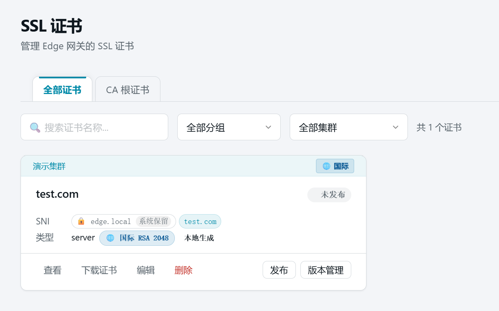
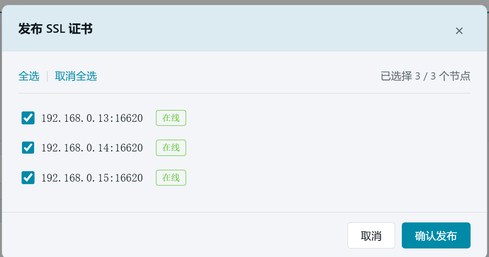
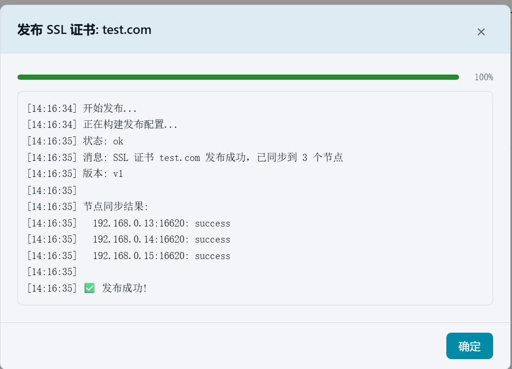

# 14. 服务器证书与发布

> 本章场景：用第 13 章生成的"演示根证书"签发一张 `test.com` 服务器证书，并发布到全部节点。服务器证书必须发布到节点才能被网关的 HTTPS 监听使用。

## 14.1 服务器证书是什么

- 由 CA 根证书（第 13 章）签发、绑定域名（如 `test.com`）的实际 HTTPS 证书；
- 网关收到 HTTPS 请求时按 SNI 自动选择证书完成握手；
- **必须发布到节点**才能生效；证书私钥仅保存在平台端，列表与详情页不回显（下载走独立通道）。

## 14.2 生成服务器证书

1. 点击左侧侧边栏：【证书管理】→【服务器证书】（页面顶部警示横幅：服务器证书请勿分发给终端用户，用户系统应安装 CA 根证书），点击右上角【生成证书】按钮。

   
2. 按下表填写：

   | 字段 | 本例填写 | 说明 |
   | --- | --- | --- |
   | 证书算法 | 【RSA 2048】 | 与根证书一致 |
   | 所属集群 | 【演示集群】 | 选择后才会加载该集群的根证书 |
   | 签发 CA（根证书） | 【演示根证书 (rsa)】 | 由第 13 章生成的根证书签发 |
   | 证书名称 | `test.com` | 唯一标识 |
   | 通用名称 CN | `test.com` | 证书主体域名 |
   | 组织 (O) / 组织单位 (OU) | 可留空 | 默认 EMBRACE / EDGE |
   | 域名 SAN | 输入 `test.com` 后按 Enter | 系统保留域名 `edge.local` 已预置 |
   | IP SAN | 可留空 | 如需按 IP 访问可添加 |
   | 有效期 | 默认 365 天 | |

   

   

3. 点击【生成并保存】。系统在本地完成密钥生成与签发，对话框底部显示执行记录。

   

4. 点击【关闭】。列表出现"test.com"证书卡片，状态为"未发布"。

   

   > 💡 生成的证书支持【下载证书】导出 `.crt` 文件（不含私钥）。注意：**终端用户系统应安装的是 CA 根证书，而非服务器证书**；证书更新后已下载副本即失效，需重新下载。客户端证书（mTLS 用）请在对应证书的「查看」抽屉中下载完整安装包。

## 14.3 发布证书

服务器证书必须发布到节点才能生效：

1. 在"test.com"证书卡片上点击【发布】。
2. 在弹出的节点选择窗口中点击【全选】选中全部 3 个节点。

   

3. 点击【确认发布】，等待发布结果。

   

   > ⚠️ 如果出现「部分成功」，说明某台节点管理端口可能不通，需要修复该节点后重新发布。其余节点不受影响。

## 14.4 验证

发布完成后，"test.com"卡片显示【已发布】徽章和版本号（v1）。

## 14.5 本章小结

- 服务器证书由第 13 章的根证书签发，签发后**必须发布**到节点。
- 本例签发了 `test.com` 服务器证书（SAN 含 test.com，有效期 365 天）并发布成功。
- 证书发布成功后即可在附录 D 的域名绑定中使用。

下一步：[16. 四层代理（TCP 端口转发）](16-stream-proxy.md)
