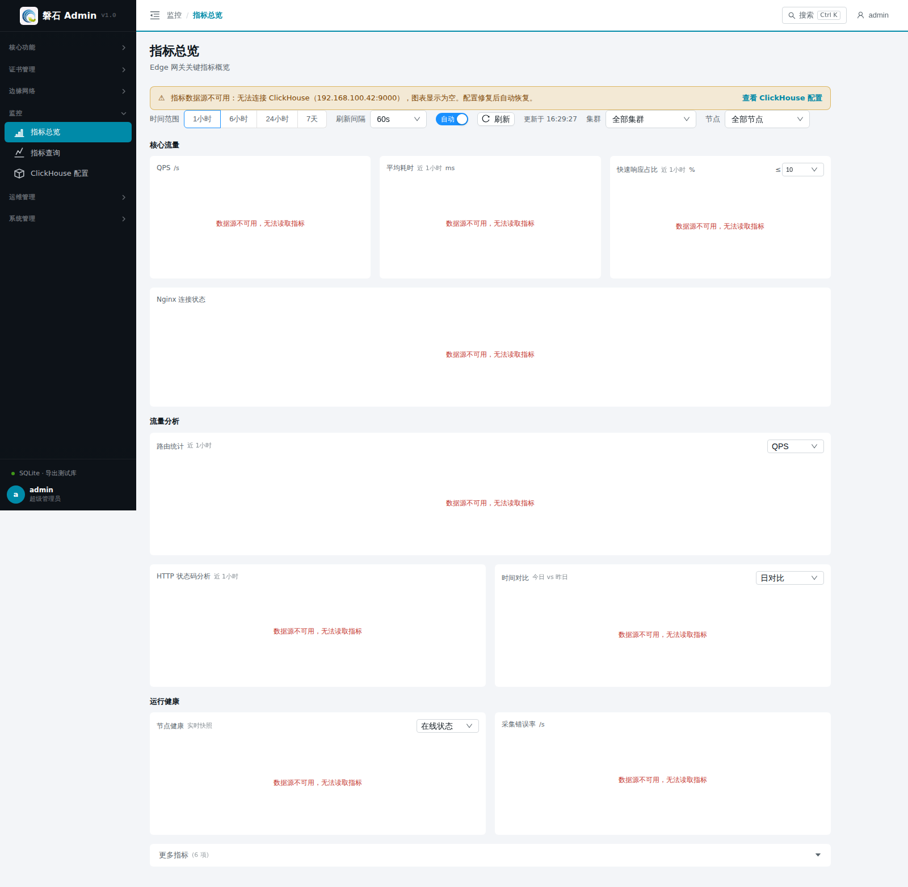

# 19. 指标总览

> 本章场景：网关跑起来之后，回答"**流量怎么样**"的问题——QPS 多少、连接数多少、有没有错误。【指标总览】是全局仪表盘：看趋势、看分布、看扩展分析。单指标深入分析用【指标查询】（第 20 章）。它们与第 2 章「概览」分工不同：概览看资源与健康（运维视角），本篇看流量与性能（性能视角）。

## 19.1 数据前提

> ⚠️ 指标数据来自 **Edge 节点上的采集器持续上报到 ClickHouse**，不是平台自己产生的。看到数据需要同时满足：  
> 1. 节点在线且已启用（第 5 章）；
> 2. 节点上的采集器正常运行；
> 3. 平台能访问 ClickHouse（esapm 链路）。

任一条件不满足时，页面显示「当前无数据」或空图表。排查顺序：

| 步骤 | 检查 | 方法 |
| --- | --- | --- |
| ① 节点状态 | 三台节点是否在线 | 【节点管理】列表状态列；掉线先解决连通性（[15.3.4 发布失败排查](15-edge-env.md)） |
| ② 采集器 | 节点上采集进程是否存活 | 登录节点查看采集器进程/日志；确认其配置指向本平台 |
| ③ ClickHouse | 平台侧存储是否可达 | 到[第 21 章 ClickHouse 配置](21-clickhouse-config.md)确认连接地址已正确配置且测试通过 |

## 19.2 页面入口

点击左侧侧边栏：【监控】→【指标总览】。

> 若菜单不可见：回[第 1 章 功能开关前置检查](01-login.md)核对 `metrics` 开关。

## 19.3 全局控制

| 控件 | 说明 |
| --- | --- |
| 时间范围 | 1 小时 / 6 小时 / 24 小时 / 7 天，切换后所有业务图重新加载 |
| 刷新间隔 | 60s / 120s / 300s，自动刷新周期 |
| 自动/手动开关 | 关闭后仅手动点【刷新】时拉取 |

## 19.4 业务图表

| 图表 | 含义 | 关注点 |
| --- | --- | --- |
| QPS | 每秒请求数（窗口内增量统计） | 流量突增/跌零 |
| 平均耗时 | 请求处理耗时均值（窗口增量 ΔSum/ΔCount，毫秒） | 与快速响应占比对照看劣化时段 |
| 快速响应占比 | 处理耗时 ≤ 阈值的请求占比（%，**窗口聚合**口径，与下方分布条同源），阈值下拉可选采集桶边界（10/20/50… ms） | 健康态贴近 100%；明显下落说明尾部变慢 |
| \**Nginx 连接状态*\* | 四条序列：活跃（蓝）/ 读取中（紫）/ 写入中（青）/ 等待中（灰），带图例 | 写入中飙升常见于慢客户端；活跃数长期高位需扩容 |
| 采集错误率 | 指标采集错误数增量 | 持续非零说明采集链路异常 |

核心流量第一行下方还有一条**耗时区间分布**：按采集桶边界列出各耗时区间**自身**的请求占比（如 `10–20ms 0.03%`，区间为左开右闭，即 10 < 耗时 ≤ 20 ms），与上方「≤ 阈值」累计口径互补；悬停可看各区间请求次数，色点由绿到红表示区间由快到慢，零占比区间置灰显示，窗口内无请求时整条隐藏。

## 19.5 扩展分析

- **路由统计**：按路由维度聚合的 QPS / 带宽 / 错误率 / 延迟排行；
- **HTTP 状态码分析**：2xx/4xx/5xx 占比，5xx 升高优先排查上游；
- **时间对比**：今日 vs 昨日请求量对比与变化率；
- **节点健康**：各节点最近上报状态。

## 19.6 更多指标（折叠区）

点击底部「更多指标」展开基础设施类指标：共享字典容量/剩余、采集耗时、采集样本数、新增序列数、采集目标状态（up）。日常巡检不必常开。

## 19.7 验证

主线搭建完成且有真实流量后，QPS 图应出现波动而非直线为零；Nginx 连接状态图的「等待中」通常为常态基线，「活跃」随请求出现尖峰。

## 19.8 本章小结

- 数据前提：节点在线 + 采集器运行 + ClickHouse 可达，缺一则「当前无数据」
- 总览看趋势（QPS/平均耗时/快速响应占比/连接状态/错误率 + 耗时区间分布 + 扩展分析）
- 所有计数器卡片均为**窗口内增量**口径，读数时勿与累计总量混淆

下一步：[20. 指标查询](20-metrics-query.md)
