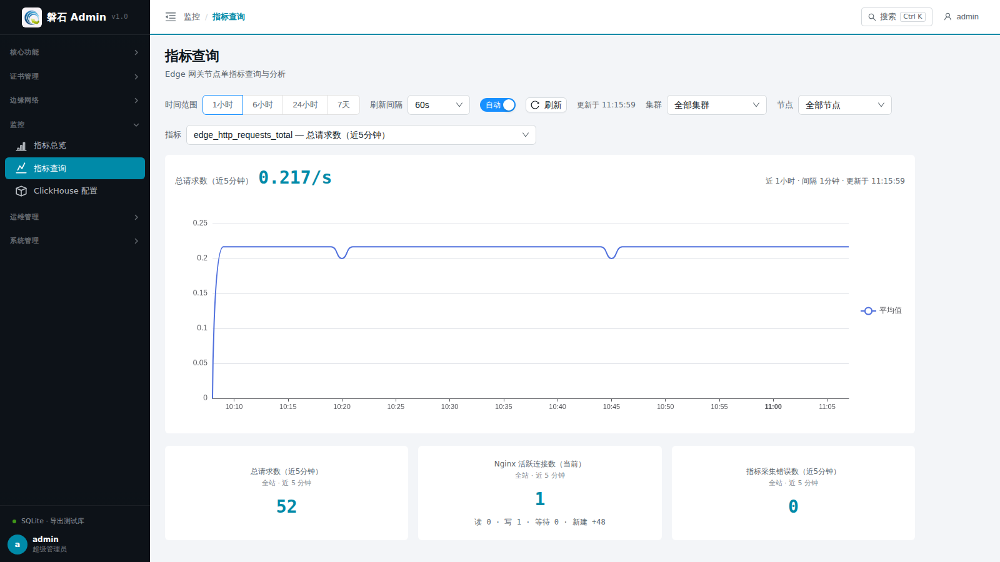

# 20. 指标查询

> 本章场景：【指标查询】做**单指标深入分析**——按指标名检索、按集群/节点筛选、看单序列明细。全局趋势请用【指标总览】（第 19 章）。

## 20.1 页面入口

点击左侧侧边栏：【监控】→【指标查询】。

> 若菜单不可见：回[第 1 章 功能开关前置检查](01-login.md)核对 `metrics` 开关。数据前提与排查顺序同[19.1 数据前提](19-metrics-dashboard.md)。

## 20.2 查询控制

| 控件 | 说明 |
| --- | --- |
| 指标 | 按域分组（业务流量与连接 / HTTP 延迟与带宽 / 插件 / 共享字典 / 采集器与节点），支持输入关键词按名称或中文说明搜索；默认选中「总请求数」 |
| 时间范围 | 1 小时 / 6 小时 / 24 小时 / 7 天，切换后重新查询 |
| 集群 / 节点 | 两级筛选，仅影响查询图；选中项与指标、时间范围会同步到地址栏，刷新/分享不丢失 |
| 刷新间隔 / 自动开关 / 刷新 | 60s（默认）/ 120s / 300s；关闭自动后仅点【刷新】时拉取；「更新于」为最近一次完成时刻 |

## 20.3 查询结果卡

头部为该指标的读数与口径标注。**普通指标**显示最近一个统计桶的读数（计数器类带 `/s` 速率后缀；字节类自动换算为 KB/MB/GB），口径为「近 {时间范围} · 间隔 {聚合间隔}」。**HTTP 状态码计数**为专项呈现：头部是窗口内请求总数，图表按状态类（2xx/3xx/4xx/5xx）横向条形展示组成与百分比——因为该指标的价值就在状态码维度，合并速率线看不出问题。

部分指标（共享字典容量/剩余、HTTP/插件延迟最大最小值、带宽、上游状态）在采集端按维度（字典名/路由/插件名等）分为多条序列，查询图为**全部序列的聚合视图**，头部会有「聚合视图」徽标说明，可按节点筛选缩小范围。

加载中显示骨架；查询失败给出原因与【重试】；数据源正常但窗口内无样本时提示「该指标在所选时间范围内无上报数据」。图上悬停可看逐桶均值/最大值。

## 20.4 业务汇总卡（近 5 分钟）

三张卡固定显示（总请求数 / Nginx 活跃连接数 / 指标采集错误数），口径为**全站**（不随集群/节点筛选变化，卡上已标注）；数据缺失显示 `--`。点击卡片可直接把该指标载入上方查询。

## 20.5 验证

在浏览器打开几次 `<https://test.com:50000/api/ping`（附录 B），回到指标查询页选 `edge_http_requests_total`，约 1 分钟内可见增量。

## 20.6 本章小结

- 查询页做单指标下钻：按指标名检索 + 集群/节点筛选 + 地址栏同步分享
- 三张业务汇总卡固定全站口径，点击即载入查询
- 计数器读数为最近统计桶速率（`/s`），勿与累计总量混淆

下一步：[21. ClickHouse 配置](21-clickhouse-config.md)
