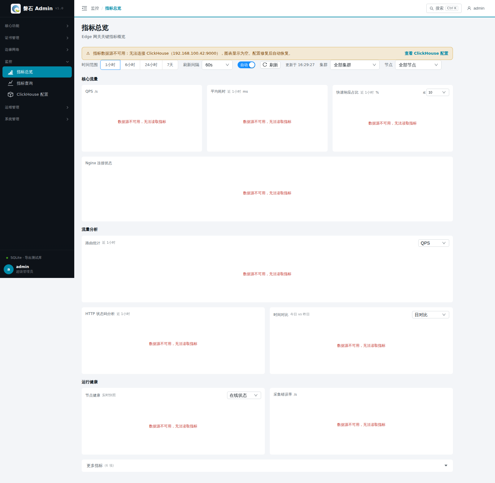
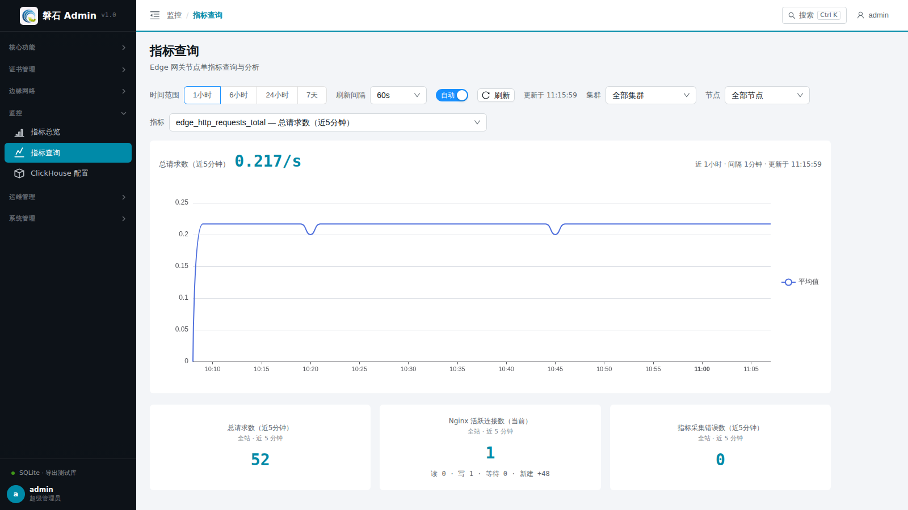

# 24. 指标总览与指标查询

> 本章场景：网关跑起来之后，回答"**流量怎么样**"的问题——QPS 多少、连接数多少、有没有错误。本章覆盖两个页面：【指标总览】看全局趋势，【指标查询】做单指标深入分析。它们与第 14 章「概览」分工不同：概览看资源与健康（运维视角），本页看流量与性能（性能视角）。

## 24.1 数据前提

> ⚠️ 指标数据来自 **Edge 节点上的采集器持续上报到 ClickHouse**，不是平台自己产生的。看到数据需要同时满足：  
> 1. 节点在线且已启用（第 3 章）；
> 2. 节点上的采集器正常运行；
> 3. 平台能访问 ClickHouse（esapm 链路）。

任一条件不满足时，页面显示「当前无数据」或空图表。排查顺序：

| 步骤 | 检查 | 方法 |
| --- | --- | --- |
| ① 节点状态 | 三台节点是否在线 | 【节点管理】列表状态列；掉线先解决连通性（[第 4 章 3.4](04-edge-env.md)） |
| ② 采集器 | 节点上采集进程是否存活 | 登录节点查看采集器进程/日志；确认其配置指向本平台 |
| ③ ClickHouse | 平台侧存储是否可达 | 到[第 21 章 ClickHouse 配置](21-clickhouse-config.md)确认连接地址已正确配置且测试通过 |

## 24.2 页面入口

- 【综合】→【指标总览】：全局仪表盘
- 【综合】→【指标查询】：单指标分析

> 若菜单不可见：回[第 1 章 功能开关前置检查](01-login.md)核对 `metrics` 开关。

## 24.3 指标总览

### 24.3.1 全局控制

| 控件 | 说明 |
| --- | --- |
| 时间范围 | 1 小时 / 6 小时 / 24 小时 / 7 天，切换后所有业务图重新加载 |
| 刷新间隔 | 60s / 120s / 300s，自动刷新周期 |
| 自动/手动开关 | 关闭后仅手动点【刷新】时拉取 |

### 24.3.2 业务图表

| 图表 | 含义 | 关注点 |
| --- | --- | --- |
| QPS | 每秒请求数（窗口内增量统计） | 流量突增/跌零 |
| 平均耗时 | 请求处理耗时均值（窗口增量 ΔSum/ΔCount，毫秒） | 与快速响应占比对照看劣化时段 |
| 快速响应占比 | 处理耗时 ≤ 阈值的请求占比（%，**窗口聚合**口径，与下方分布条同源），阈值下拉可选采集桶边界（10/20/50… ms） | 健康态贴近 100%；明显下落说明尾部变慢 |
| \**Nginx 连接状态*\* | 四条序列：活跃（蓝）/ 读取中（紫）/ 写入中（青）/ 等待中（灰），带图例 | 写入中飙升常见于慢客户端；活跃数长期高位需扩容 |
| 采集错误率 | 指标采集错误数增量 | 持续非零说明采集链路异常 |

核心流量第一行下方还有一条**耗时区间分布**：按采集桶边界列出各耗时区间**自身**的请求占比（如 `10–20ms 0.03%`，区间为左开右闭，即 10 < 耗时 ≤ 20 ms），与上方「≤ 阈值」累计口径互补；悬停可看各区间请求次数，色点由绿到红表示区间由快到慢，零占比区间置灰显示，窗口内无请求时整条隐藏。

### 24.3.3 扩展分析

- **路由统计**：按路由维度聚合的 QPS / 带宽 / 错误率 / 延迟排行；
- **HTTP 状态码分析**：2xx/4xx/5xx 占比，5xx 升高优先排查上游；
- **时间对比**：今日 vs 昨日请求量对比与变化率；
- **节点健康**：各节点最近上报状态。

### 24.3.4 更多指标（折叠区）

点击底部「更多指标」展开基础设施类指标：共享字典容量/剩余、采集耗时、采集样本数、新增序列数、采集目标状态（up）。日常巡检不必常开。

## 24.4 指标查询

页面自上而下三部分：

### 24.4.1 查询控制

| 控件 | 说明 |
| --- | --- |
| 指标 | 按域分组（业务流量与连接 / HTTP 延迟与带宽 / 插件 / 共享字典 / 采集器与节点），支持输入关键词按名称或中文说明搜索；默认选中「总请求数」 |
| 时间范围 | 1 小时 / 6 小时 / 24 小时 / 7 天，切换后重新查询 |
| 集群 / 节点 | 两级筛选，仅影响查询图；选中项与指标、时间范围会同步到地址栏，刷新/分享不丢失 |
| 刷新间隔 / 自动开关 / 刷新 | 60s（默认）/ 120s / 300s；关闭自动后仅点【刷新】时拉取；「更新于」为最近一次完成时刻 |

### 24.4.2 查询结果卡

头部为该指标的读数与口径标注。**普通指标**显示最近一个统计桶的读数（计数器类带 `/s` 速率后缀；字节类自动换算为 KB/MB/GB），口径为「近 {时间范围} · 间隔 {聚合间隔}」。**HTTP 状态码计数**为专项呈现：头部是窗口内请求总数，图表按状态类（2xx/3xx/4xx/5xx）横向条形展示组成与百分比——因为该指标的价值就在状态码维度，合并速率线看不出问题。

部分指标（共享字典容量/剩余、HTTP/插件延迟最大最小值、带宽、上游状态）在采集端按维度（字典名/路由/插件名等）分为多条序列，查询图为**全部序列的聚合视图**，头部会有「聚合视图」徽标说明，可按节点筛选缩小范围。

加载中显示骨架；查询失败给出原因与【重试】；数据源正常但窗口内无样本时提示「该指标在所选时间范围内无上报数据」。图上悬停可看逐桶均值/最大值。

### 24.4.3 业务汇总卡（近 5 分钟）

三张卡固定显示（总请求数 / Nginx 活跃连接数 / 指标采集错误数），口径为**全站**（不随集群/节点筛选变化，卡上已标注）；数据缺失显示 `--`。点击卡片可直接把该指标载入上方查询。

## 24.5 验证

1. 主线搭建完成且有真实流量后，QPS 图应出现波动而非直线为零；
2. 在浏览器打开几次 `<https://test.com:5000/api/ping`（第> 12 章），回到指标查询页选 `edge_http_requests_total`，约 1 分钟内可见增量；
3. Nginx 连接状态图的「等待中」通常为常态基线，「活跃」随请求出现尖峰。

## 24.6 本章小结

- 数据前提：节点在线 + 采集器运行 + ClickHouse 可达，缺一则「当前无数据」
- 总览看趋势（QPS/平均耗时/快速响应占比/连接状态/错误率 + 耗时区间分布 + 扩展分析），查询页做单指标下钻
- 所有计数器卡片均为**窗口内增量**口径，读数时勿与累计总量混淆

下一步：[第 23 章 统一管理](23-central-management.md)
