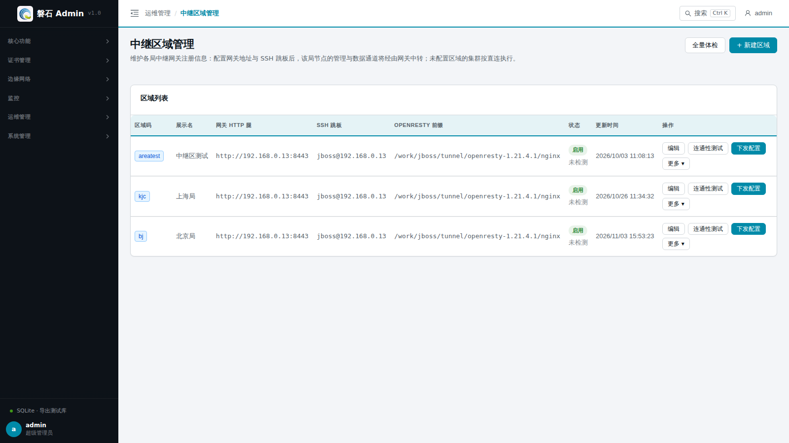
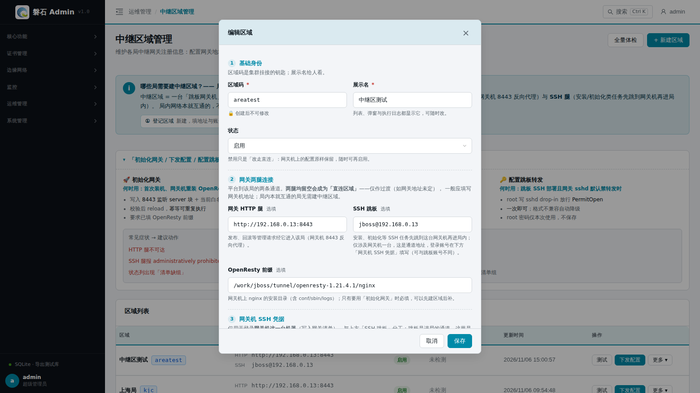
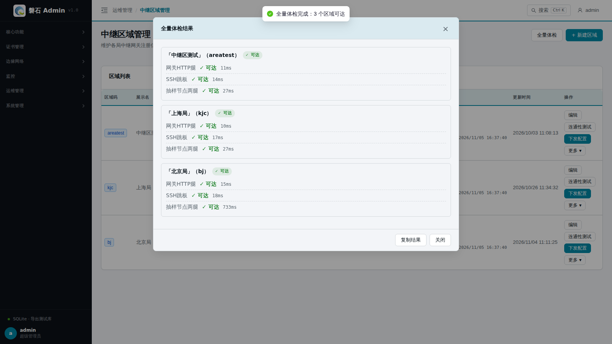
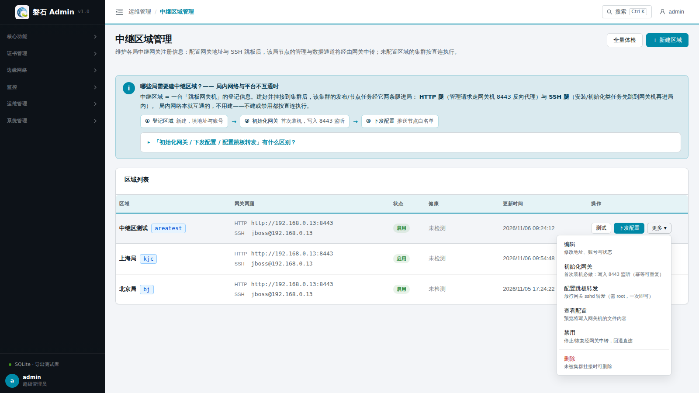
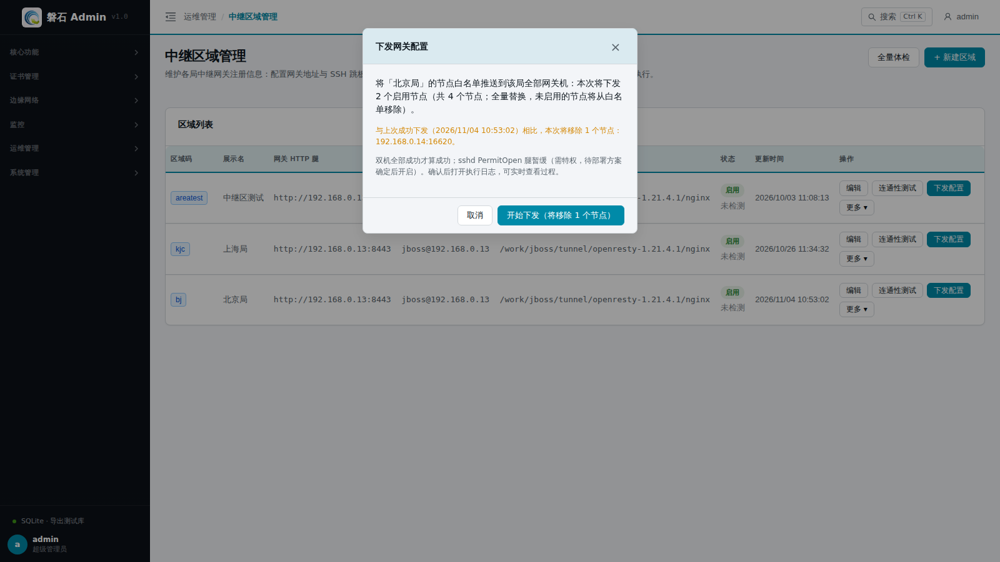
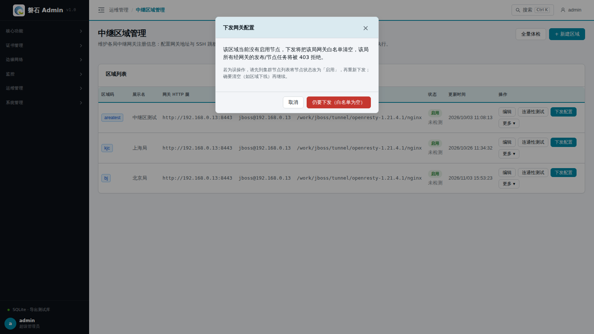

# 32. 中继区域管理

> 维护各局中继网关的注册信息。区域注册并初始化后，挂接到该区域的集群节点，其管理通道与发布流量将经由该局网关机中转；未挂接区域的集群按现状直连执行。首次装机流程：**新建区域 → 初始化网关 → 集群挂接区域 → 下发配置**。

## 32.1 页面入口

点击左侧侧边栏：【运维管理】→【中继区域管理】。

> 若菜单不可见：回[第 1 章 功能开关前置检查](01-login.md)核对 `relay_gateway` 开关。

## 32.2 区域列表与新建

列表展示全部已注册区域：

| 列 | 说明 |
| --- | --- |
| 区域码 | 区域唯一标识（小写字母开头），集群通过它挂接区域 |
| 展示名 | 界面显示名称，如「北京局」 |
| 网关 HTTP 腿 | 该局网关的反向代理地址（留空 = 该局直连） |
| SSH 跳板 | 跳板专用账号与网关地址（留空 = SSH 直连） |
| OpenResty 前缀 | 网关机上 OpenResty 的安装目录 |
| 状态 | 启用 / 禁用（禁用后该区域回退直连），行内同时显示最近一次体检结果 |
| 更新时间 | 最近一次修改时间 |
| 操作 | 高频三项 + 「更多」菜单（见 32.4） |

点击右上角【+ 新建区域】打开表单：

| 字段 | 规则 |
| --- | --- |
| 区域码 | 小写字母开头，仅含小写字母/数字/中划线，长度 2-32；**创建后不可修改** |
| 展示名 | 必填 |
| 状态 | 启用 / 禁用（该区域回退直连） |
| 网关 HTTP 腿 | 须以 `http://` 或 `https://` 开头，如 `http://10.10.1.1:8443`；留空 = 直连 |
| SSH 跳板 | 须为 `账号@主机[:端口]`，如 `tunnel@10.10.1.1:22`；留空 = SSH 直连 |
| OpenResty 前缀 | 须为以 `/` 开头的绝对路径，如 `/work/jboss/tunnel/openresty-1.21.4.1/nginx` |

格式不符时保存会被内联提示拦截（红字标在对应字段下方），不会产生错误配置：

## 32.3 健康体检

- **全量体检**：点击页头【全量体检】一次探测全部区域；单个区域用行内【连通性测试】。
- **结果弹窗**：按区域分组、分段逐条展示（网关 HTTP 腿 / SSH 跳板 / 抽样节点两腿，含用时与失败原因），可【复制结果】留存。探测为真实网络 IO，**关闭弹窗不会中断探测**，完成后列表中的健康状态仍会更新。
- **健康状态列**：每行持久显示最近一次体检结果（✓ 可达 / ✗ 失败摘要 / 未检测）与体检时间，鼠标悬停查看全部分段明细。体检为只读的时点探测，不落库，刷新页面后回落「未检测」。

> 排障提示：若分段显示「目标不在该局网关白名单，请执行配置下发」，说明该局节点尚未进入网关白名单——对该区域执行一次【下发配置】即可。

## 32.4 网关操作

行内保留高频三项：【编辑】/【连通性测试】/【下发配置】；其余操作收进【更多 ▾】下拉：

| 操作 | 说明 |
| --- | --- |
| 初始化网关 | 首次装机必做：向该局网关机写入 8443 监听配置与当前白名单并启动/重载 OpenResty；幂等可重复执行 |
| 配置跳板转发 | 以 root 在网关机放行 SSH 跳板转发（需 root 密码，仅本次使用不保存） |
| 查看配置 | 只读预览待写入网关机的全部文件内容，可复制——ansible 不可用时可据此手工落地 |
| 禁用 / 启用 | 禁用后该区域回退直连路径执行 |
| 删除 | 区域仍被集群挂接时将拒绝删除（红字置底） |

**下发配置**把该局节点白名单推送到该局全部网关机（双机全部成功才算成功）。注意三点：

1. **全量替换**：每次下发都以当前节点实况整体覆盖白名单——节点增删、启停、换 IP 之后，都需要重新下发一次。
2. **只有「启用」状态的节点才会进入白名单**。若区域当前没有启用节点，下发会弹红色危险确认：白名单将被清空、该局所有经网关的发布/节点任务将被 403 拒绝。如为误操作，请先到【集群管理】的节点列表将节点状态改为「启用」，再重新下发；确认要清空（如区域下线）才继续。
3. **漂移提示**：确认弹窗会对比当前启用节点与**上次成功下发**的清单——将移除节点时以橙色警示行列出（如「本次将移除 1 个节点：192.168.0.14:16620」），确认按钮同步标注移除数；仅新增时以灰字提示；从未下发过的区域提示「首次写入白名单」。提示基于平台侧快照（非网关机实况），下发成功后自动更新。

## 32.5 集群挂接区域

在【集群管理】编辑集群时选择所属区域（区域码）。绑定或换绑后，须对该区域执行一次【下发配置】，否则该局节点经网关访问会被 403 拒绝（保存集群成功时会弹「需下发网关配置」引导）。
